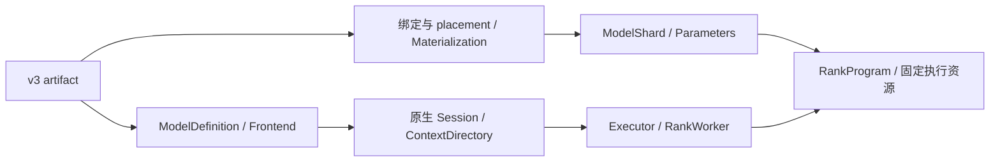
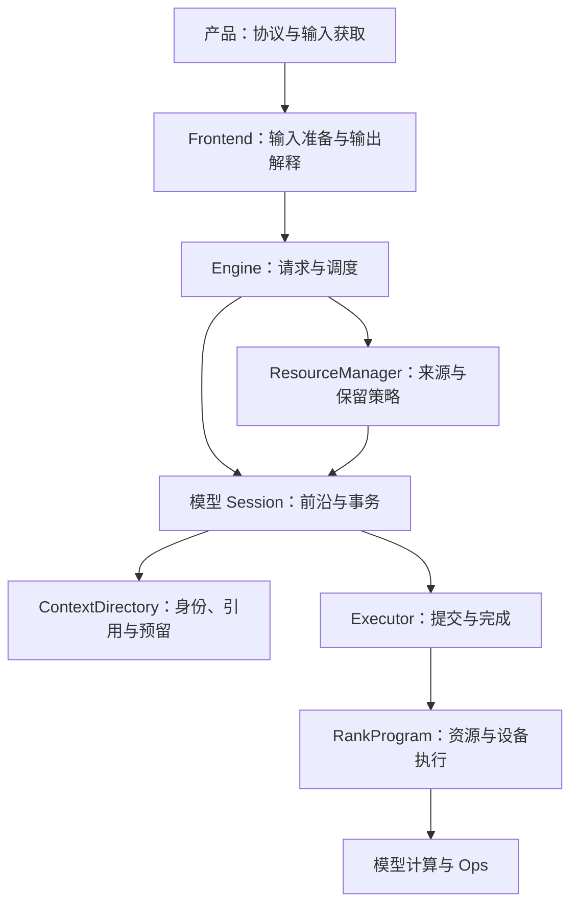
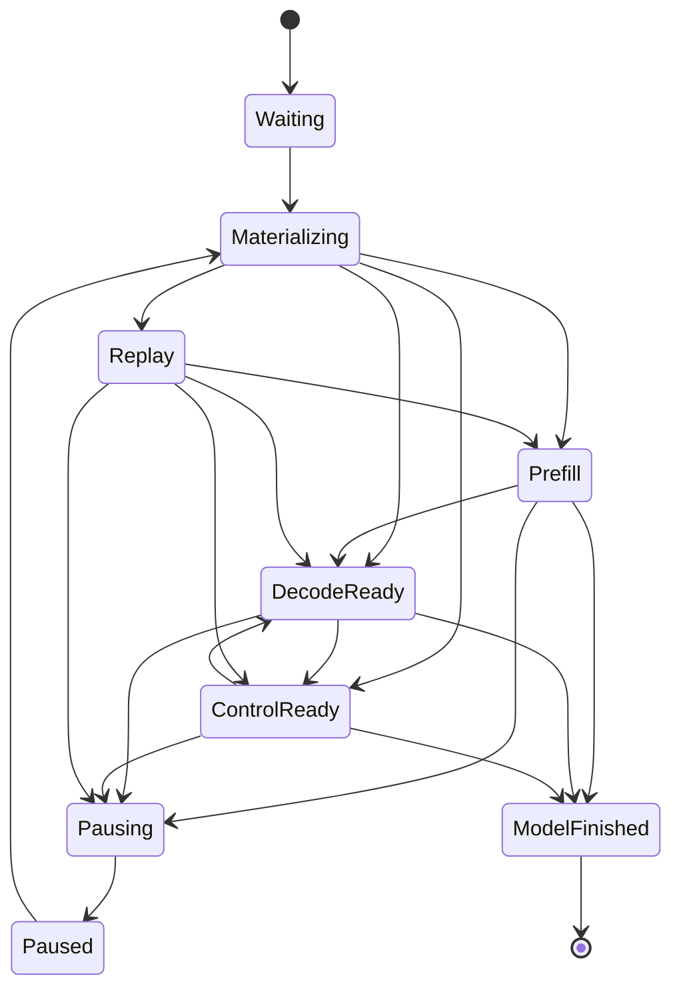

# Engine 架构

NInfer 由公共 Engine 组织模型执行。CLI、Serve、推理基准和 PPL 使用同一入口；
原生模型保留自己的层序、状态数学和 Op 组合。Checkpoint 名称与量化 recipe 不创建另一套执行架构。
本文说明跨模块关系；具体类型与行为以所属代码的合同为准。

## 1. 产品执行模型

编译目标由 [Build system](build-system.md)定义：`rtx5090` 与 `dgx_spark` 各自选择本地源码和
优化实现，模型 Config 与 Op 数学接口保持独立。一个模型实例由协调侧 Session 和一个或多个
RankWorker 组成，启动时固定 `max_concurrency=1..8`。单 rank 由 LocalExecutor 在进程内执行；
多 rank 由 DistributedExecutor 分发统一执行计划，通信与分片由对应模型实现。
各 rank 独立拥有设备权重、固定执行资源和 Context backing。

Generation 使用有界等待队列，resident 请求按有限执行单元取得资源；压力下可以暂停与恢复。
紧凑 decode/control 批次与分块 prefill、Replay 共用调度、提交和结果发布机制。
Text、Vision、prefix reuse、MTP、DFlash/DFlash2、CLI 和 HTTP serving 均通过公共 `ninfer::Engine`。
Artifact 必须提供 Text；启动独立选择 Vision，以及 none 或一个 speculative backend，只准备所选功能。

Engine purpose 在启动时固定。CausalScoring 也通过原生 Session 和 Executor 执行，串行处理评分 job，
使用临时 State 与 Main KV；不进入 Generation Scheduler 或上下文缓存，评分 staging 只在该 purpose 下分配。

### 1.1 架构、定义与权重

原生模型代码拥有数学公式、层连接、Op 调用顺序和状态转移。Config 提供层数、维度、
Attention/GDN 分布及 expert 几何。架构入口为 `Qwen3_5ForCausalLM`、`Qwen3_5MoeForCausalLM`
与 `Qwen4ExpForCausalLM`；后者当前支持 Text/Vision/MTP。Checkpoint 与可处理的表示组合使用同一架构入口。
本 fork 将 `Qwen4ExpForCausalLM` 绑定到 Qwen3.8-Flash-Next，并保留 Text、Vision、MTP 和
CausalScoring。该包使用自己的 Session、RankProgram 和状态布局，不继承 Qwen3.5 执行实现。
源集成与硬件资格分别记录在[移植记录](upstream-ports.md#flash-next-v3)。

V3 artifact 保存配置、物理对象、逻辑参数 Binding、使用位置的 Use 和 Frontend 资源。
Converter 负责源映射、量化或保值导入、合并投影、packing 与 layout；loader 验证并按存储表示物化权重。
全局 ModelDefinition 拥有配置、模型身份、绑定描述和 Frontend 资源，独立于设备权重实例存活。
ModelShard 拥有本 rank 的不可变权重与 backing；const Parameters 借用这些权重和执行 profile。



`metadata.name` 提供公开实例名称，缺省使用架构名称；服务可用 `--model-id` 覆盖公开别名。
执行支持由实际 Parameters、规划和 Ops 决定。文件合同见[容器规范](artifact-container.md)，
数值解释与 planes 见[数值格式](tensor-formats.md)和[存储布局](storage-layouts.md)。

## 2. 所有权与调用边界



| 所有者 | 决定与持有的内容 |
|---|---|
| 产品层 | 协议、输入获取、连接、启动配置呈现和结果编码 |
| Frontend | Tokenizer、模板、媒体准备、输入身份；每请求的输出解析与 grammar 状态 |
| Engine / Scheduler | 请求生命周期、输出预算、执行成员、公平性、取消与暂停恢复机会 |
| ResourceManager | 恢复来源、前缀索引、缓存保留价值与回收权限 |
| 模型 Session | Token 账本、Main/backend 前沿、工作需求、checkpoint 与生成事务 |
| ContextDirectory | 逻辑 State/history/page 身份、内容覆盖、引用、分配预留和迁移事务 |
| Executor | Frame 额度、ticket、命令顺序、决策交接和参与 rank 的完成条件 |
| RankProgram | Context backing、frame、workspace、Graph、原生计算与物理存储动作 |
| ModelDefinition / ModelShard | 全局配置与绑定描述 / 本 rank 不可变权重及其 backing |
| Ops / Core | 数学与局部状态变换 / 通用存储、设备执行和传输机制 |

配置解析只解释自身结构。模型准备入口解释并行策略；加载器解释存储表示；Op 决定实际几何与
计算表示是否支持。调用方通过合同组织输入和传播原因，不维护另一份下层支持表。

Session、Work 和 RankProgram 保持原生模型类型。Executor 的抽象位于一次执行及其生命周期边界，
逐层计算仍由模型直接调用 Op。单 rank 使用进程内 LocalExecutor，多 rank 使用
[分布式执行](distributed-execution.md)，共享提交与完成语义。

## 启动与资源准备

启动从 artifact 建立无设备权重的 ModelDefinition，再由模型计划确定本地权重、状态布局和执行资源。
转换、绑定与分片物化的分工见[权重与加载](weights-and-loading.md)。

模型提供记录布局、必要工作集和执行资源需求；公共启动层据此选择容量。必要工作集覆盖单请求
最大上下文、基本并发和所选 backend 的执行峰值，不承诺所有并发同时达到最大长度。
State 与 KV 使用[统一 Context 容量](context-management.md)，固定权重、workspace、records、
Vision 窗口和通信资源分别由其 owner 计费。互斥 scratch 取峰值，跨阶段存活的数据按真实重叠计费。

Binder 根据架构/config 建立 ModelDefinition 中的逻辑需求；resolve_load 建立 placement，
Materializer 按原编码建立稳定 backing。同一物理 parent 在各位置分别去重，CPU/GPU 双端来源可由一次有界 I/O 分发。
Frontend 的资源由 Definition 拥有，不借用稍后可能被销毁的权重候选。
Qwen3.5 MoE 和 Flash-Next Main 优先选择完整 GPU 常驻候选；固定权重与必要执行资源无法
同时容纳时，再选择 Host experts 和 RankProgram 所有的 GPU cache，不同时持有两个模型。
`runtime/engine/startup.inl` 统一预算、Graph 校准和有界重建；模型提供固定数学对应的准备描述。
校准资源销毁后重新查询可用显存，避免将保留的驱动开销与重建估计重复扣费。
Windows 桌面预留和并发限制属于启动预算，不能由完整 GPU 候选绕过。

- 规划 headroom 为未精确计入的启动增长留余量，可以在正式准备中消耗。
- 必须保留的 Host 容量保障媒体等已声明的运行需求，初始化后仍需满足。
- 最终预算检查针对整个实例的实际占用；不能再次要求规划 headroom 完整空闲。

容量求解接收已经扣除保留量的净额度。准备分配使用允许消耗 headroom 的额度，避免重复扣费。
独显分别核算 Device 与 Host；共享物理内存目标把 Host backing、控制元数据和媒体额度计入同一
物理预算。容量可以按 rank 不同，不以两机内存之和证明某个 rank 的工作集可行。

权重和必要通信资源准备后，以小型合法 Context 绑定准备实际 Graph 集合。先预热、捕获并释放，
再测重建捕获的增长；释放后重新取快照，用重建估计规划正式容量。仍被驱动保留的内存已经在
快照中，不重复扣费。正式资源与控制侧目录建立后再核验总预算，自动容量允许有界纠偏，
显式容量保持原要求。模型、Op 和实际分配错误保留自身原因。

实现入口：[启动预算](../../src/runtime/engine/startup_memory.h)、
[容量求解](../../src/runtime/engine/context_capacity.h)、
[Graph 准备](../../src/models/common/graph_preparation.h)。

## 请求与执行

Frontend 产生拥有自身输入和媒体寿命的 PreparedPrompt；请求独占 OutputSession。
Engine 的控制 worker 是调度状态、缓存策略与 Session 的修改者。Ingress、输出消费者和网络线程
通过队列、取消标志和完成事件交接，不直接操作模型存储。

请求可以等待、绑定、执行、暂停、恢复和结束。一次执行冻结 sequence、residency 与 batch 行映射；
lane 的复用不改变旧 ticket 的成员身份。暂停保存请求的输出会话、账本、预算和恢复目标，
恢复可以绑定新的 lane。Replay 重建数学状态，不重复发布旧输出、采样或计入生成预算。

调度先消费完成和终态事件，为必要恢复及已驻留请求取得执行许可，再以余量接纳新请求。
Control、紧凑 Decode 和分块 Prefill/Replay 共享这套生命周期。Prefill 内部的媒体和数学分段
由模型推进，不自动形成新的调度轮次。缓存与抢占规则见[Context 管理](context-management.md)。

Session 组合 Context 预留与 Executor 额度后，才进入不可撤销的目录准备。许可包含后续决定、
提交或丢弃所需的资源；不能计算完再竞争用于提交的空间。尚未提交的独立预留可以撤销；
已经接受的 COW、映射和传输必须履行到完成边界。

## 提交、发布与退役

copy_bytes/copy_bytes_async 表达通用字节传输；CUDA async 的 CPU 端须为 pinned memory。
KV 保留自己的布局传输接口。Tensor 和 span 不携带就绪状态，顺序由执行事件和 owner 管理。

models/common/moe 提供 bank、cache、混合执行和资源组件，实例归 RankProgram。
共享专家及其余固定权重驻留 GPU；Main routed experts 可使用注册的 CPU 来源。缓存、预取和 bridge
不属于请求 StateImage，不随请求回滚或暂停。模型负责 Main/MTP 放置和层连接，Ops 负责格式、shape 分派和数学。
`Write` 输出独立 block，`AddResidual` 加回已有输出，HC 等连接保留在模型中。

### 2.7 CPU 执行基础

CpuTopology 发现允许的 CPU、物理核和缓存关系，启动解析线程数与 affinity；媒体自动线程数至多 16。
TaskPool 为独立任务提供固定线程和有界 FIFO，Frontend 媒体与 HTTP 使用独立实例，避免相互等待同一队列。
立即提交被拒绝不消费任务；阻塞提交可以检查取消。任务拥有结果和异常通道，关闭停止新提交后排空并 join。

CpuExecutor 拥有固定绑核团队并产生 CpuExecutionView，团队 ISA 为各 worker 的交集。
同步 collective 向全队发布工作，返回时写入对调用方可见；提交线程不参与，团队不接受嵌套或并发 collective。
worker 使用 nearest-even、屏蔽异常和 gradual underflow。团队只提供 rank、连续范围分工与 barrier，
scratch 由调用方分配。keep_active() 在相邻 collective 间维持轮询，退出后恢复有限自旋与休眠，空闲请求期间不持有。

CPU 团队不调用 CUDA，也不拥有传输槽、模型状态或权重副本。RTX 5090 的 MoE offload 由 RankProgram
取得 GPU 输入就绪事实后调用现有团队，再提交 GPU 汇合。MoE 策略由实际 token 列数决定，
prefill、Replay、decode、control 和 verify 共用该选择。

## 3. 请求生命周期



Materializing 包含来源 lease、传输和目的安装；完整采用后才使序列可执行。
Capture 是 resident 请求的暂时执行门，未完成时不进入该请求的模型 unit。
ModelFinished 后 Engine 仍持有 lane，直到设备退役、finish/release 和缓存结算完成。

### 3.1 暂停与恢复

Session 在已提交执行边界完成暂停，返回 owning ResumeState。Snapshot 保留完整 State/KV；
Replay 保留输入、accepted ledger、RNG 与 backend metadata，恢复时重建缺失历史。
Engine 保留同一个请求、OutputSession、生成预算和已发布结果；恢复可使用另一 lane。

Replay 不重复发布历史、不重复计数或采样。Snapshot 是可回收加速资源，撤销后仍可 Replay。
恢复取得“旧 frontier + 首个真实新单元”的完整许可，跨 chunk 保留；同时最多一条受保护恢复。
到达旧 frontier 本身不结束保护，真实新进展或终态才结束；期间跳过可选 capture。

#### Reasoning feature collection

`ExecutionOptions::capture_reasoning_features` is an opt-in training readout. It accepts a text
new-assistant prompt with a positive output budget. The Frontend records
`PromptSummary::reasoning_frontier` right after the generation header, before the `<think>`
opener, when that byte boundary is an exact token frontier. Raw-token prompts, assistant
continuation and media requests have no frontier and are rejected at submission. It is not an HTTP
extension or an adaptive serving policy.

Engine disables prefix reuse and publication for these requests. Request planning and Program
prefill both split at the frontier, so the feature row is computed as for a prompt that ends there,
independent of the action-dependent suffix. Program copies the final-normalized BF16 row into a
pinned request-owned host buffer during prefill and expands it exactly to FP32 after the prefill
completes; Engine moves it into `GenerationResult::reasoning_features` before the lane can be
reused. The result stays empty when collection was not requested. No device allocation or
numerical Op is added. Callers collecting paired modes must use identical leading instructions:
`ninfer-reasoning-collect` uses Medium reasoning effort, which adds no effort preamble, and
verifies exact feature equality across its actions.

### 3.2 Outstanding capacity

非零输出请求成功 submit 后占一个 outstanding 名额，暂停不归还。释放同时要求 response_done
与 consumer_released；两者任意先后，容量只释放一次。放弃 GenerationHandle 只设置取消与 consumer_released，
consumer 线程不调用 Session 或 RankProgram。

### 3.3 Continuation 与命名 session

活动 continuation 可写，checkpoint 是不可变的完整恢复点。一个私有 owner 可以持有多个恢复点并共享 KV history。
产品 session key 是查找提示，与原生 ModelSession 对象不同。单调 publication_order 防止较早请求晚结束时
覆盖较新 session binding。具体来源和共享发布规则见[上下文缓存](resource-scheduling-and-context-cache.md)。

## 4. Worker、资源与执行

Engine worker 是控制状态、Scheduler、ResourceManager、Session 和本地执行推进的唯一修改者。
Ingress、consumer、transport 通过队列、原子取消标志和响应事件交互。LocalExecutor 直接调用本进程
RankProgram，不增加消息编码、远程队列或额外执行线程。

每个 worker cycle 先消费执行与上下文完成、处理取消和终态，再按恢复优先及原票号为 resident 取得 unit 许可，
用余量尝试 fresh admission，然后安排 Control、一个 compact Decode batch 和一个 Prefill/Replay turn。
同周期已执行 Control 的行不得再次 Decode；异步事件到达不重新获得整轮调度机会。

Session 原子取得一个调用集合的 typed 需求，Engine 逐行形成可运行子集。Fresh admission 可能新增
共享尾页依赖，因此最终提交仍核对 context_blocks。一行不足或等待复制不阻止其他已许可且无依赖的行。
普通 unit 增量预留，恢复许可保留尚需覆盖；回收策略由 ResourceManager 决定。

当前 rank 有一套 Compute frame 和独立 Context frame。Compute 等待决策或提交时不覆写其 records；
Context 事务可以与无冲突工作交错。每条 sequence 的源、目的、mapping、传输窗口和执行输入被冻结到相应完成边界。
PLE 的 producer/upload/consumer、MoE 的输入就绪/CPU contribution/汇合由 rank 内部推进，控制侧不调度逐层算子。
执行预留只取得 frame 及其后续控制命令额度；原生 Work 描述形状和数学变体，由 rank 校验。
所有 Compute 结果需要 commit/discard，Context 完成后直接退役。

Admission 由队列变化、容量释放、事务完成等事件启动有界扫描，普通 decode 前进不反复重启失败扫描。
未完成工作由 Executor poll 推进；空闲等待不能给每个 decode 完成固定增加一次定时器延迟。
只有 Context 在途且没有进展时不重跑空调度周期；完成事件、队列通知及到期请求触发下一次边界处理。

## 5. 提交、完成与发布

### 5.1 四个执行事实

| 事实 | 含义 |
|---|---|
| Submitted | 执行方接管拥有型 Work 和 frame |
| ResultReady | 候选结果可供控制侧解释；提交数据和 frame 仍在使用 |
| CommitReceipt | 最终提交已被有序接受，Session 可以采用逻辑结果 |
| DeviceRetired | 最后消费者结束，可以结算租约和复用存储 |

生成先产生 provisional 结果。Frontend preview 确定符合 EOS、停止、预算和取消要求的实际前缀；
模型接受提交后，Session 更新账本与前沿，OutputSession 才正式接受并发布输出。
提交失败不能留下已经对外发布却没有模型状态支持的 token。

接受长度驱动 State fold、history 覆盖、conditioning 和计数更新。未采用后缀可能仍留有物理字节，
但不成为可恢复内容。可观察结果返回、逻辑采用与最终异步退役各有边界；
[观测与测量](observability.md)沿用这些事实。

Context 事务则在复制、映射和必要参与者退役后发布副本或绑定。取消撤销结果采用意图，
不提前结束 DMA、Graph、Host producer 或来源借用。不可恢复的设备、通信或账本错误使实例失败；
清理保留首个原因，停止提交并结束在途消费者，再释放资源。

## 设备执行与 Graph

设备视图从 owning DeviceContext 向下传递；Tensor、Weight 和 Arena 表达实际位置与借用。
Host scope 结束不意味着设备完成。跨 stream 的存储复用由 owner 建立依赖。
CPU 任务池处理独立任务，CPU collective 团队服务算术；模型调度拥有它们与 CUDA 的交接。

Eager 与 Graph 使用同源数学组合。图绑定稳定 backing、frame 和执行表，实际请求通过 offsets、
positions、有效长度和行映射进入。图变体只表达必要的物理几何与计算主体；采样配置、实际采用长度
和请求身份作为数据输入。Attention 的局部节点更新遵循 Op 合同，不改变外层通信次序。

需要 Host grammar、CPU expert 或最终接受结果的边界显式交接。可捕获的连续设备段保持完整，
PLE 的数据来源本身不决定 Main 切图。图、事件和注册视图先于其借用的 backing 销毁。
各模型的组合差异见模型文档和[Speculative 执行](speculative-decoding.md)。

## 维护入口

- [Runtime](../../src/runtime/engine/)负责生命周期、启动、调度和发布。
- [Executor](../../src/runtime/executor/)负责执行与完成合同。
- [Models](../../src/models/)各自维护配置、绑定、Session、Program 和层计算。
- [Frontend](frontend.md)、[Context](context-management.md)、[分布式](distributed-execution.md)
  与[观测](observability.md)分别维护跨模块设计。

```text
Frontend preview、必要 Host 容量检查
  → Session 准备 accepted-prefix 逻辑与物理提交
  → Executor 接受提交，返回 receipt
  → Session 采用账本与前沿
  → Engine 生成预算记账
  → OutputSession commit 并发布输出
  → DeviceRetired 后完成资源结算
```

提交前检查生成缓存容量、相对 boundary metadata 和成员身份。模型提交被拒绝或失败时，OutputSession preview 不提交。
KV 的提交准备只整理 provisional 页与退役租约，不推进 committed frontier；接收后才采用前沿、State epoch、
token identity 与恢复保护状态。采用所需的 Host 容量在接收前准备，后续设备完成再归还旧页及补足增长预留。
后续工作继承执行顺序，terminal response 仍等待资源与缓存 owner 结算。
Forced control 使用相同事务，token 由 Frontend 给出，不调用 sampler 或推进采样 RNG。
初次 admission 后、任何输出 delta 前发布一次 GenerationStart，恢复不重复发布。

工具输出包含正文/思考增量、调用开始、参数增量和调用结束。请求独占 decoder 在 commit 后推进，
HTTP 写入由消费线程完成。聚合与 streaming 共用参数转码，工具序号在请求内稳定，协议 ID 由适配器产生。
InProgress、Complete、Incomplete 分开表示，未完成参数保留已发布 JSON 前缀。

output_error 区分自由生成格式错误与受约束合同违规。已完成该批提交后结束相关 sequence，分别结算
InvalidToolOutput 或内部错误；可隔离的解析失败不使整个 Engine 失效。工具参数状态与 matcher 一同参与
mask、preview、commit/discard，暂停保留，Replay 不再次消费历史参数。

### 5.4 MTP 的统一轮间状态

设 Main 已计算 `[0,F)`，账本有待输入的已确认 anchor `x[F]`。稳定边界为：

```text
Main frontier = F
MTP history frontier = max(F-1, 0)
saved conditioning = H[F-1]
```

MTP 在位置 p 消费 `H[p] + embedding(x[p+1])`。Qwen3.5 conditioning 为 target hidden，
Qwen4Exp 为 HC conditioning，具体数值运算由各自数学实现定义。

本轮先 Draft，再以 `[anchor, drafts...]` 执行 Main Verify，然后 Decision/Commit。
最终采用 A 个输出时，Main 前沿为 `F+A`，MTP history 为 `F+A-1`，保存 target 第 A−1 列 conditioning。
Draft 第一步写出的真实 history 可以保留；后续使用 draft conditioning 的 provisional history
按真实 target conditioning 重建，不直接作为 committed history。

Prefill、Replay、Control 采用相同的 backward alignment：根块跳过首 token；后续块先使用保存的
上一位置 conditioning，再使用本块 target conditioning。它们只建立 history，不生成跨轮携带的 drafts。
精确前缀命中先从 tail hidden 采样 anchor，下轮正常进入 Draft。K=0、ragged draft extent、部分终态采用
都遵守相同前沿；Vision embedding 的 token 位置与 conditioning/RoPE 位置分别解释。

## 6. 结束、取消与失败

正常结束由 Session 将可保留 continuation 交给 ResourceManager，或释放序列；缓存索引、命名 session
与终态资源结算完成后，Engine 归还 lane 并形成最终 response。

Waiting 请求可直接取消；绑定和传输中的请求先完成或撤销对应事务；resident 在 accepted 工作退役后结束；
paused 释放 ResumeState 和相关 owner。取消不改写 in-flight mapping，已发布输出不回退。

Queue timeout、overload、输入超限和不可表示请求属于请求级拒绝。身份/generation 不一致、错误成员、
不可稳定提交的物理 mutation、目录完整性损坏或执行错误使整个实例失败，不能解释为 cache miss。
Cleanup 停止提交，保留最初错误，尝试排空各执行和 producer，再释放 resident/paused/cache owners 并完成响应。
实际资源不足返回策略层；不可撤销准备之后的内部失败不作为普通准入不足重试。

## 7. 物理执行与 CUDA Graph

RankProgram 按同源 Parameters、Use 与容量计划准备资源。互斥 scratch 取峰值；跨阶段存活的
hidden、conditioning、verify records 和 Vision handoff 保留到最后消费者。Host ingress、decision mask、
accepted lengths 和 mapping staging 在 H2D 完成前不覆写；egress 在 D2H 与控制侧消费都结束后复用。

Graph 绑定固定 frame 和 backing。合法 exact-B topology 在启动准备，page IDs、sequence、State selectors
作为输入变化；长度档位描述资源范围，不复制 Attention Op 私有分派边界。同类 Graph 更新合同由 Op 提供。
Qwen4Exp resident Main 包含 PLE 消费和 head，Host PLE producer 在提交前准备本代次输入；
MTP draft chain 可以增量交回 IDs。需要约束或 Host producer 的边界通过显式交接推进。

MoE offload 保留分段 GPU Graph 和已优化的融合路径。mixer、GPU experts、CPU contribution、cache snapshot
及上传根据实际依赖组织；权重稳定时合并 GPU 提交，流式或恢复时保留上传重叠机会。
层遍历、speculative prefix/suffix 与拓扑共享关系仍由原生 RankProgram 定义。

Graph 校准记录准备前、准备完成和仅销毁 Graph 后的显存快照。销毁后保留的驱动开销已进入可用内存基准，
不与重建估计重复扣费；差值使用有符号数，重建增量可以为零。
MemorySummary.cuda_graph 分别报告校准增长、保留量、重建估计和正式准备增长；这些包含 CUDA 延迟加载与
驱动缓存，不能当作纯 Graph allocation 精确归因。runtime_reservation_bytes 表示 rank 的显式资源预留；
共享物理内存目标还计入 pinned staging、PLE Host 准备区等共享容量，独显目标仅计入 Device backing。
本 fork 的 Flash-Next 常驻路由保留分开的 prefix、PLE 和 suffix Graph，head/sampling 在
Main 外提交。Host expert 路由保留逐层的 start/poll/cancel 交接。每一步 MTP proposal 的
PLE 传输和可选 trace 镜像均在下一步复用工作缓冲前提交；不使用合并整条 draft chain 的图。
PLE ready/consumed 事件位于捕获的 PLE body 外，由 RankProgram 排序并按 ticket 归还槽。
显式和自动 KV 容量保留基础 headroom；桌面可用显存预留另由启动预算执行。

显式与自动 Context 容量在规划时使用 engine.memory_headroom（fork 默认 1 GiB，可设 0B）。
基础 headroom 容纳未精确计入的开销，不要求初始化后仍完整空闲，也不按拓扑重复预留。
Spark Vision live media 另行保留。正式准备以整个实例的实际占用判断预算，不要求正式增长小于估计。
最多一次容量纠偏重建，只缩减自动 KV 或可选 expert cache；显式容量与功能不变，Host 分配失败和执行错误
不作为缩减 GPU 容量的理由。

Graph warmup 使用 rank 的临时 slot/page 绑定，不建立正式 Session checkpoint 或 prefix entries。
结束异步工作后先销毁 Graph，再释放它引用的 bridge/events。Serve warmup 使用公共 Engine，关闭请求级
context cache，结束后不留下外部请求可命中的 continuation。

## 8. 核心不变量与实现位置

1. Session 解释模型前沿，ContextDirectory 是唯一空间与引用账本，rank 执行已确定的动作。
2. Scheduler 决定顺序，ResourceManager 决定保留，实际分配与 Op 决定物理可行性。
3. 完整执行许可先于不可撤销准备；恢复许可跨 chunk 保留至真实新进展或终态。
4. ResultReady、逻辑提交和 DeviceRetired 不混用；最后消费者结束前不复用 backing。
5. Checkpoint 对应同一次实际执行的完整 State/KV coverage，暂停恢复不重复输出或生成记账。
6. PendingBatch 被完整消费后才能发布输出；终态结算前保留资源所有权。
7. 单 rank 的 LocalExecutor 使用正式执行合同，逐层计算继续使用原生实现与现有 Op 分派。

| 职责 | 主要位置 |
|---|---|
| 公共 facade | `include/ninfer/engine.h`, `src/runtime/engine/engine.cpp` |
| 生命周期、周期与发布 | `src/runtime/engine/engine_core.h`, `engine_{requests,schedule,execution,metrics}.inl` |
| 实例与启动 | `src/runtime/engine/instance.h`, `startup.*`, `startup_memory.*` |
| 执行合同、frame 额度、本地 worker | `src/runtime/executor/` |
| 缓存策略、索引、成本 | `src/runtime/engine/context_cache/` |
| 模型定义、绑定、只读 shard | 各架构 `definition.*`, `load/`, `model.*` |
| 原生控制与 checkpoint | 各架构 `session/` |
| rank 资源、执行推进与 Graph | 各架构 `program/` |
| 数学实现和参数 | 各架构 `execution/`、`state/` |
| 集中目录与值动作 | `src/models/common/context/directory/`, `directory.*`, `contract.h` |
| 本地存储、动作槽与传输 | `src/models/common/context/storage.*`, `transfer.*` |
| Qwen Frontend、Vision、输入身份 | `src/models/common/qwen/` |
| 共享权重与 MoE | `src/models/common/bindings.*`, `weights.*`, `moe/` |
| Tensor、buffer、arena、Graph、物理布局 | `src/core/` |
| Artifact 与 Converter | `src/artifact/`, `tools/convert/`, `tools/artifact/` |
| Ops | `src/ops/`, `include/ninfer/ops/` |
| 协议、输入获取与 HTTP | `src/product/`, `src/media/decode/`, `src/serve/` |

公共 C++ 接口服务仓库内应用，不安装或导出 SDK。V3 `.ninfer` 是唯一 C++ 产品 artifact；
CLI、server 和 inference benchmark 均通过 Engine，converter 不提供 Python model-inference 路径。
